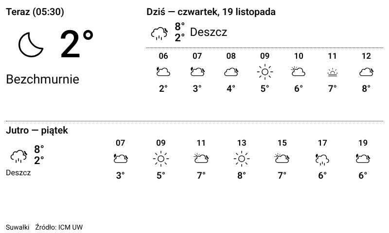

# Pogoda ICM – wtyczka do LaraPaper / TRMNL

Prognoza pogody z modelu **UM 4 km** [Meteo ICM UW](https://meteo.pl) na ekran e-ink
(800×480) w [LaraPaper](https://github.com/usetrmnl/larapaper) lub TRMNL.
Po polsku, z ikonami [Meteocons](https://github.com/basmilius/meteocons), bez klucza API.



## Co pokazuje

- **Teraz** – aktualna temperatura, ikona i opis (np. „Deszcz”, „Mgła”)
- **Dziś** – max/min, opis dnia i prognoza na 7 kolejnych godzin
- **Jutro** – max/min, opis i prognoza co 2 godziny (07–19)
- stopka z nazwą miejscowości, źródłem i godziną przebiegu modelu

Lokalizację (nazwa, szerokość i długość geograficzna) ustawia się w zakładce
ustawień wtyczki. Domyślnie: Suwałki.

## Struktura repozytorium

```
src/
  settings.yml        # konfiguracja wtyczki (polling + pola ustawień)
  full.liquid         # szablon pełnoekranowy z osadzonymi ikonami SVG
```

## Instalacja

1. W LaraPaper otwórz **Plugins & Recipes** i zaimportuj zip z katalogiem `src/`
   albo utwórz wtyczkę ręcznie:
   - strategia: **Polling**, metoda: **POST**
   - URL: `https://devmgramapi.meteo.pl/meteorograms/um4_120`
   - nagłówek: `content-type=application/json`
   - body: skopiuj `polling_body` z `src/settings.yml`
   - pola formularza: sekcja `custom_fields` z `src/settings.yml`
   - markup: zawartość `src/full.liquid`
2. W ustawieniach wtyczki wpisz nazwę miejscowości i współrzędne
   (z kropką, np. `54.1118` i `22.9309`).
3. Ustaw interwał odświeżania (np. 60 min) i dodaj wtyczkę do playlisty.

Godzina przebiegu w stopce („prognoza z 20.11 01:00”) pozwala sprawdzić,
czy dane się odświeżają – powinna zmieniać się co 12 godzin.

## Jak wyznaczany jest stan pogody

ICM nie podaje gotowego opisu pogody, więc szablon wylicza go z danych modelu:

| Warunek | Opis |
|---|---|
| `storm_max` lub `flash_max` > 0 | Burza |
| opad ≥ 0,1 mm, temp. ≤ 0° | Śnieg |
| opad ≥ 0,1 mm, temp. ≤ 1,5° | Deszcz ze śniegiem |
| opad 0,1–0,3 mm | Mżawka |
| opad ≥ 0,3 mm | Deszcz |
| widzialność < 1000 | Mgła |
| zachmurzenie < 15% / < 60% / < 85% / więcej | Słonecznie / Częściowe / Duże / Pochmurno |

Dzień i noc są liczone w przybliżeniu ze współrzędnych i dnia roku
(dokładność kilkunastu minut).

## Znane ograniczenia

- Polling nie może najpierw zapytać o listę przebiegów (`/available`), więc
  data przebiegu jest wyliczana w `polling_body` z bieżącego czasu. Jeśli Twoja
  instancja nie wykonuje filtrów Liquid w body, dane przestaną się odświeżać.
- Szablon zakłada, że serwer renderujący działa w UTC i dodaje przesunięcie
  `trmnl.user.utc_offset` (domyślnie +1 h). Gdy godziny są przesunięte o 1,
  serwer działa w czasie lokalnym.
- Jednostki części pól API (opad, wiatr, widzialność) przyjęto na podstawie
  wartości – ICM ich nie dokumentuje.
- API (`devmgramapi.meteo.pl`) jest nieoficjalne i może się zmienić.

## Licencje i źródła

- Dane: **ICM UW** – prognoza udostępniana bezpłatnie, bez reklam, z podaniem
  źródła. Wyniki modelu UM uzyskano z użyciem oprogramowania Met Office.
  Przed użyciem innym niż prywatne sprawdź regulamin ICM.
- Ikony: [Meteocons](https://github.com/basmilius/meteocons) – Bas Milius, licencja MIT.
- Inspiracja układem: [trmnl-open-meteo-weather-forecast](https://github.com/andi4000/trmnl-open-meteo-weather-forecast).
- Czcionka: Roboto (Google Fonts, licencja Apache 2.0).
